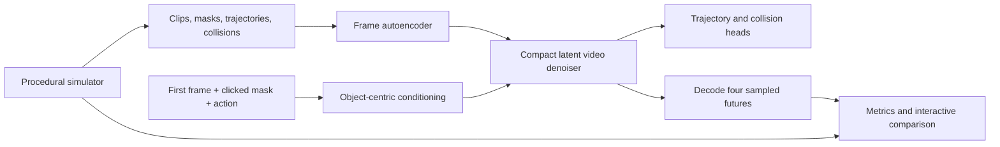

# Click2Future

### Action-conditioned video diffusion for physical futures

Select an object in a tabletop scene, draw a force arrow, and generate four possible outcomes.

Click2Future is our NTU Generative AI course project. We plan to train a small video diffusion model to predict what happens after a force is applied to an object. A tabletop simulator will generate the training clips, object trajectories, and collision labels.

**Status:** project setup. The simulator, models, and demo still need to be built.

**Submission deadline:** 14 November 2026; confirm the submission time and deliverables on the course site.

**Task owners:** all unassigned; claim work through [GitHub Issues](https://github.com/athul1810/click2future/issues).

## Start here

| If you want to… | Read… |
|---|---|
| Understand the project and scope | [Requirements](docs/REQUIREMENTS.md) |
| Assign work to the team | [Task board](docs/TASKS.md) and [open issues](https://github.com/athul1810/click2future/issues) |
| See the deadline and task dependencies | [Roadmap](docs/ROADMAP.md) |
| Implement compatible components | [Architecture and data contract](docs/ARCHITECTURE.md) |
| Design experiments and metrics | [Evaluation plan](docs/EVALUATION.md) |
| Plan GPU usage | [Compute and feasibility](docs/COMPUTE.md) |
| Contribute a change | [Contribution guide](CONTRIBUTING.md) |

## Research question

> Can a compact video diffusion model generate diverse futures while obeying an explicitly specified physical action?

We will test an **object-centric action-conditioning module** and an auxiliary head that predicts trajectories and collisions from denoiser features. The experiments will check whether each component improves the generated videos.

Hidden mass and friction can produce different outcomes from the same image and action. We will compare generated samples with several simulator rollouts to check whether the variation reflects those physical differences.

## The intended demo

1. Load a simulator scene or upload a supported synthetic tabletop image.
2. Click an object and drag an arrow to specify force direction and magnitude.
3. Generate four futures using different sampling seeds.
4. Compare them side by side with a simulator rollout and trajectory overlays.
5. Adjust the force or simulator friction and repeat.

For the core hidden-physics model, friction is **not an input**. Changing the friction slider changes the simulator comparison; it must not be presented as controlling model samples. A friction-conditioned model is a stretch goal. Simulator ground truth requires scene metadata; image-only uploads cannot provide exact ground truth.

## Scope

| Core deliverable | Stretch goal |
|---|---|
| 64×64 top-down scenes, initially 16 frames | 128×128 after the compute gate passes |
| 2-4 rigid objects, randomized appearance and hidden physics | More shapes and harder collisions |
| Compact latent video diffusion and conditional VAE baseline | Additional architecture exploration |
| Five planned experimental variants | Additional supervision ablations |
| Four sampled futures and a simulator comparison | Friction-conditioned sampling |
| Reproducible metrics, checkpoints, report, recorded demo | FVD if feasible and statistically useful |

No real robot, photorealistic 512px video, or general-purpose physics. The upload workflow targets the synthetic domain; real photographs are outside the course scope.

## System overview



## Planned experiments

| ID | Variant | Purpose |
|---|---|---|
| E0 | Conditional VAE with first frame, selected mask, and numeric action | Low-cost generative baseline |
| E1 | First-frame-only video diffusion | Measure what happens without action information |
| E2 | Diffusion with first frame, selected mask, and numeric action | Isolate spatial action encoding from target identification |
| E3 | E2 + spatial action conditioning | Test the proposed conditioning module |
| E4 | E3 + trajectory/collision supervision | Test the effect of auxiliary physics supervision |

Compare ADE/FDE, collision accuracy and F1, SSIM/LPIPS, motion-aware temporal consistency, and trajectory diversity. Evaluate held-out shapes, textures, and force magnitudes separately. [Evaluation details](docs/EVALUATION.md) define fairness controls and the limits of each metric.

## Four workstreams

Divide these areas across the team. Each issue should have one lead and a reviewer.

| Workstream | Main responsibility | Owner |
|---|---|---|
| A: Simulator and data | Physics, rendering, labels, splits, ground-truth replay | Unassigned |
| B: Generative models | Autoencoder, CVAE, diffusion baselines, action module | Unassigned |
| C: Evaluation and experiments | Metrics, supervision integration, ablations, analysis | Unassigned |
| D: Integration and delivery | Demo, reproducibility, compute coordination, report assembly | Unassigned |

Each person writes up the methods, results, and limitations of their work. See the [task board](docs/TASKS.md) for dependencies and acceptance criteria.

## Deadline

**14 November 2026.** Confirm the exact submission time and required deliverables on the course site. Intermediate milestones and task dates will be agreed by the team later.

## Repository layout

```text
.github/             Issue and pull-request templates
docs/                Scope, task board, roadmap, interfaces, evaluation, compute
src/click2future/     Planned Python implementation modules
configs/             Planned simulator/model/experiment configurations
experiments/         Run manifest template and experiment records
results/             Small result tables and report figures
app/                 Planned interactive demo
tests/               Planned simulator, contract, and model smoke tests
```

Setup and training commands will be added in T03 once the environment is tested. The implementation folders currently contain planning notes.

## First team meeting

- Assign T01-T04 and a reviewer for each; confirm the course requirements and GPU application.
- Agree on the action semantics and dataset contract before generating the main dataset.
- Claim the remaining issues by workstream and check their dependencies.
- Use the 64px pilot to decide the dataset and training budget; keep 128px optional.

## Context and references

In the supplied 5 October 2026 email, Prof. Xingang Pan supported the Click2Future direction, noted that TC2 GPU Cluster resources are available for MSc coursework through the course application process, and recommended a modest model and experimental scope. An allocation has **not** been confirmed.

- [BAIR robot-pushing dataset](https://www.tensorflow.org/datasets/catalog/bair_robot_pushing_small): a related action/video dataset; the TFDS catalog lists 43,264 training sequences at 64×64. It is background context, not our planned training dataset.
- [BudgetGate repository](https://github.com/shrijeet-maiti-burner/ai6101-budgetgate): inspiration for the documentation-first team workflow. Click2Future is a separate project and repository.

## Results

No experiments have been run. Add measured results with run IDs, configs, seeds, and checkpoint references to [results/](results/).
