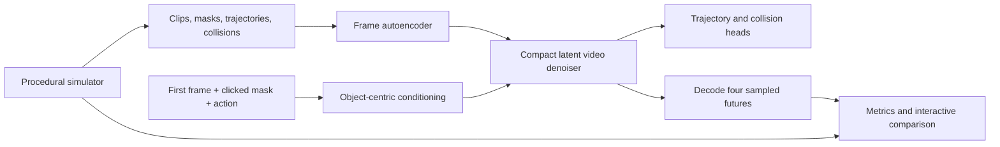

# Click2Future

### Action-conditioned video diffusion for physical futures

Select an object in a tabletop scene, draw a force arrow, and generate four possible outcomes.

Click2Future is our **AI6132 Generative AI For Visual Synthesis** project at NTU. For Project 1: Technical Review, we will compare a conditional VAE and video diffusion for predicting tabletop motion after a force is applied. A procedural simulator will generate the clips, trajectories, and collision labels. We also plan to test object-centric conditioning and auxiliary physics supervision.

**Status:** project setup. The simulator, models, and demo still need to be built.

**Working deadline:** 14 November 2026. See [submission details](docs/SUBMISSION.md) for the course-brief date discrepancy.

**Workstream owners:** A: Sanjay; B: Shrijeet; C: Athul and Ananya; D: unassigned. See the [task board](docs/TASKS.md).

**Compute:** TC2 access is approved for Athul. The account has a one-GPU limit and a six-hour job limit. Verify the GPU model and VRAM before setting the training budget. See [compute details](docs/COMPUTE.md).

## Group 7

| Member | NTU username |
|---|---|
| PRAMOD SANJAY | sanjay009 |
| KAPOOR ANANYA | kapo0001 |
| MAITI SHRIJEET | shrijeet001 |
| BOBAN ATHUL KRISHNA | athulkri001 |

Coordinator: **PRAMOD SANJAY**, following the course rule that the first person listed in the group is the coordinator.

## Start here

| If you want to… | Read… |
|---|---|
| Understand the project and scope | [Requirements](docs/REQUIREMENTS.md) |
| Prepare the three required submission files | [Submission guide](docs/SUBMISSION.md) |
| Draft the report and contribution statement | [Report outline](docs/REPORT_OUTLINE.md) and [contribution template](docs/CONTRIBUTION_TEMPLATE.md) |
| Assign work to the team | [Task board](docs/TASKS.md) and [open issues](https://github.com/athul1810/click2future/issues) |
| See the deadline and task dependencies | [Roadmap](docs/ROADMAP.md) |
| Implement compatible components | [Architecture and data contract](docs/ARCHITECTURE.md) |
| Design experiments and metrics | [Evaluation plan](docs/EVALUATION.md) |
| Find papers for the method and report | [Research references](docs/REFERENCES.md) |
| Plan GPU usage | [Compute and feasibility](docs/COMPUTE.md) |
| Contribute a change | [Contribution guide](CONTRIBUTING.md) |

## Research question

> Can a compact video diffusion model generate diverse futures while obeying an explicitly specified physical action?

We will test an **object-centric action-conditioning module** and an auxiliary head that predicts trajectories and collisions from denoiser features. The experiments will check whether each component improves the generated videos.

Hidden mass and friction can produce different outcomes from the same image and action. We will compare generated samples with several simulator rollouts to check whether the variation reflects those physical differences.

## The intended demo

1. Load a simulator scene or upload a supported synthetic tabletop image.
2. Click an object and drag an arrow to specify force direction and magnitude.
3. Generate four futures using different sampling seeds.
4. Compare them side by side with a simulator rollout and trajectory overlays.
5. Adjust the force or simulator friction and repeat.

For the core hidden-physics model, friction is **not an input**. Changing the friction slider changes the simulator comparison; it must not be presented as controlling model samples. A friction-conditioned model is a stretch goal. Simulator ground truth requires scene metadata; image-only uploads cannot provide exact ground truth.

## Scope

| Planned project work | Stretch goal |
|---|---|
| 64×64 top-down scenes, initially 16 frames | 128×128 after the compute gate passes |
| 2-4 rigid objects, randomized appearance and hidden physics | More shapes and harder collisions |
| Compact latent video diffusion and conditional VAE baseline | Additional architecture exploration |
| Five planned experimental variants | Additional supervision ablations |
| Four sampled futures and a simulator comparison | Friction-conditioned sampling |
| Reproducible experiments, technical report, contribution PDF, source code | FVD if feasible and statistically useful |

The course requires at least two methods, one evaluation dataset, and a report of at least four pages. Five variants and the interactive demo are our project plan, not additional course submission requirements. Checkpoints and any demo recordings stay in the team's working files.

No real robot, photorealistic 512px video, or general-purpose physics. The upload workflow targets the synthetic domain; real photographs are outside the course scope.

## System overview



## Planned experiments

| ID | Variant | Purpose |
|---|---|---|
| E0 | Conditional VAE with first frame, selected mask, and numeric action | Low-cost generative baseline |
| E1 | First-frame-only video diffusion | Measure what happens without action information |
| E2 | Diffusion with first frame, selected mask, and numeric action | Isolate spatial action encoding from target identification |
| E3 | E2 + spatial action conditioning | Test the proposed conditioning module |
| E4 | E3 + trajectory/collision supervision | Test the effect of auxiliary physics supervision |

Compare ADE/FDE, action-direction error, collision accuracy and F1, SSIM/LPIPS, motion-aware temporal consistency, and trajectory diversity. Evaluate held-out shapes, textures, and force magnitudes separately. [Evaluation details](docs/EVALUATION.md) define fairness controls and the limits of each metric.

## Four workstreams

C is shared by Athul and Ananya. Agree on the implementation split within each shared task and choose reviewers separately.

| Workstream | Main responsibility | Owner |
|---|---|---|
| A: Simulator and data | Physics, rendering, labels, splits, ground-truth replay | PRAMOD SANJAY |
| B: Diffusion | Autoencoder, diffusion training/sampling, numeric and spatial action conditioning | MAITI SHRIJEET |
| C: Evaluation and physics | Tracking, trajectory/collision metrics, uncertainty, experiments, auxiliary supervision with B | BOBAN ATHUL KRISHNA and KAPOOR ANANYA |
| D: CVAE, compute, and integration | CVAE baseline, reproducible jobs/run records, sampler-to-demo integration | Unassigned |

D still needs an owner for the CVAE baseline and integration work. Report assembly and submission tasks also remain unassigned. Each person writes up the methods, results, and limitations of their work. See the [task board](docs/TASKS.md) for dependencies and acceptance criteria.

## Submission

One submission per group through NTULearn, containing exactly:

- `group_07_report.pdf`: main report, at least four pages.
- `group_07_contribution.pdf`: each member's contribution.
- `group_07_code.zip`: source code, with no datasets, model files, or external links.

Use `07` for Group 7 in all three filenames. No cloud-hosted substitutes or external links in the submitted material. Follow the [submission guide](docs/SUBMISSION.md); do not ZIP the working repository wholesale.

## Repository layout

```text
.github/             Issue and pull-request templates
docs/                Scope, task board, roadmap, interfaces, evaluation, compute
src/click2future/     Planned Python implementation modules
configs/             Planned simulator/model/experiment configurations
experiments/         Run manifest template and experiment records
results/             Small result tables and report figures
app/                 Planned interactive demo
tests/               Planned simulator, contract, and model smoke tests
```

Setup and training commands will be added in T03 once the environment is tested. The implementation folders currently contain planning notes.

## First team meeting

- Assign the remaining setup, CVAE, integration, and delivery tasks and choose reviewers; start T04 after the scope decision. Check the course requirements and verify TC2 login and a small GPU job.
- Agree on the action semantics and dataset contract before generating the main dataset.
- Claim the remaining issues by workstream and check their dependencies.
- Use the 64px pilot to decide the dataset and training budget; keep 128px optional.

## References

See [Research references](docs/REFERENCES.md) for the baselines, diffusion models, and evaluation metrics.

## Results

No experiments have been run. Add measured results with run IDs, configs, seeds, and checkpoint references to [results/](results/).
