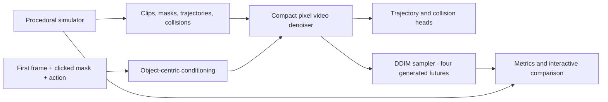

# Click2Future

### Action-conditioned video diffusion for physical futures

Select an object in a tabletop scene, draw a force arrow, and generate four possible outcomes.

Click2Future is our **AI6132 Generative AI For Visual Synthesis** project at NTU. For Project 1: Technical Review, we will compare a conditional VAE and video diffusion for predicting tabletop motion after a force is applied. A procedural simulator will generate the clips, trajectories, and collision labels. We also plan to test object-centric conditioning and auxiliary physics supervision.

**Status:** the simulator, controlled/OOD datasets, model trainers and evaluation
pipeline are implemented. Evaluation covers trajectories, contacts, image quality,
uncertainty and action controls. Contact timing remains an approximate proxy.

CVAE and diffusion pilots now run on TC2, with complete saved-state continuation
verified. Both still fail generated-video quality checks. Main trained comparisons,
held-out action/uncertainty results and the demo remain open. See the
[task board](docs/TASKS.md), [GPU checks](docs/results/cvae-training-checks.json),
[experiment protocol](docs/EXPERIMENT_PROTOCOL.md) and
[working report draft](report/README.md).

**Working submission deadline:** 14 November 2026. See [submission details](docs/SUBMISSION.md) for the course-brief date discrepancy.

**Workstream owners:** A: Sanjay; B: Shrijeet; C: Athul and Ananya; CVAE: Ananya proposed, awaiting acceptance; demo integration: Shrijeet. See the [task board](docs/TASKS.md).

**Compute:** the course-provided TC2 A40 setup and scheduled training are verified,
including deterministic CVAE CUDA backward. Each account has a one-GPU,
six-hour-job limit. Measured costs and unreported quota details are in
[compute details](docs/COMPUTE.md).

## Group 7

| Member | NTU username |
|---|---|
| PRAMOD SANJAY | sanjay009 |
| KAPOOR ANANYA | kapo0001 |
| MAITI SHRIJEET | shrijeet001 |
| BOBAN ATHUL KRISHNA | athulkri001 |

Coordinator: **PRAMOD SANJAY**, following the course rule that the first person listed in the group is the coordinator.

## Start here

| If you want to… | Read… |
|---|---|
| Execute the plan for the 14 November PPT presentation | [16 October execution plan](docs/EXECUTION_PLAN_2026-10-16.md) and [demo specification](app/DEMO_SPEC.md) |
| Prepare for the 14 October project meeting | [Meeting brief](docs/MEETING_2026-10-14.md) |
| Assess relevant SOTA and choose an achievable build path | [Research review](docs/SOTA_2026-10-14.md) and [build plan](docs/BUILD_PLAN.md) |
| Set up a TC2 environment | [TC2 workflow](cluster/README.md) and [access status](docs/TC2_ACCESS.md) |
| Understand the project and scope | [Requirements](docs/REQUIREMENTS.md) |
| Prepare the three required submission files | [Submission guide](docs/SUBMISSION.md) |
| Draft the report and contribution statement | [Report outline](docs/REPORT_OUTLINE.md) and [contribution template](docs/CONTRIBUTION_TEMPLATE.md) |
| Assign work to the team | [Task board](docs/TASKS.md) and [open issues](https://github.com/athul1810/click2future/issues) |
| See the deadline and task dependencies | [Roadmap](docs/ROADMAP.md) |
| Implement compatible components | [Architecture and data contract](docs/ARCHITECTURE.md) |
| Design experiments and run implemented metrics | [Evaluation plan](docs/EVALUATION.md) and [metric usage](docs/METRICS.md) |
| Find papers for the method and report | [Research references](docs/REFERENCES.md) |
| Plan GPU usage | [Compute and feasibility](docs/COMPUTE.md) |
| Contribute a change | [Contribution guide](CONTRIBUTING.md) |

## Research question

> Can a compact video diffusion model generate diverse futures while obeying an explicitly specified physical action?

We will test an **object-centric action-conditioning module** and an auxiliary head that predicts trajectories and collisions from denoiser features. The experiments will check whether each component improves the generated videos.

Hidden mass and friction can produce different outcomes from the same image and action. We will compare generated samples with several simulator rollouts to check whether the variation reflects those physical differences.

## The intended demo

1. Load a simulator scene or upload a supported synthetic tabletop image.
2. Click an object and drag an arrow to specify force direction and magnitude.
3. Generate four futures using different sampling seeds.
4. Compare them side by side with a simulator rollout and trajectory overlays.
5. Adjust the force or simulator friction and repeat.

For the core hidden-physics model, friction is **not an input**. Changing the friction slider changes the simulator comparison; it must not be presented as controlling model samples. A friction-conditioned model is a stretch goal. Simulator ground truth requires scene metadata; image-only uploads cannot provide exact ground truth.

## Scope

| Planned project work | Stretch goal |
|---|---|
| 64×64 top-down scenes, 32-frame simulator pilot | 128×128 after the compute gate passes |
| 2-4 rigid objects, randomized appearance and hidden physics | More shapes and harder collisions |
| Compact video diffusion and conditional VAE baseline; pixel path adopted | Reconstruction-gated latent architecture |
| E0/E2/E3 core; E1/E4 gated ablations | Additional supervision ablations |
| Four sampled futures and a simulator comparison | Friction-conditioned sampling |
| Reproducible experiments, technical report, contribution PDF, source code | FVD if feasible and statistically useful |

The course requires at least two methods, one evaluation dataset, and a report of at least four pages. E1/E4 and advanced demo features are gated additions to the core comparison. Checkpoints and any demo recordings stay in the team's working files.

No real robot, photorealistic 512px video, or general-purpose physics. The upload workflow targets the synthetic domain; real photographs are outside the course scope.

## System overview



## Planned experiments

| ID | Variant | Purpose |
|---|---|---|
| E0 | Conditional VAE with first frame, selected mask, and numeric action | Low-cost generative baseline |
| E1 | First-frame-only video diffusion | Measure what happens without action information |
| E2 | Diffusion with first frame, selected mask, and numeric action | Isolate spatial action encoding from target identification |
| E3 | E2 + spatial action conditioning | Test the proposed conditioning module |
| E4 | E3 + trajectory/collision supervision | Test the effect of auxiliary physics supervision |

Compare ADE/FDE, action-direction error, collision accuracy and F1, SSIM/LPIPS, motion-aware temporal consistency, and trajectory diversity. Evaluate held-out shapes, textures, and force magnitudes separately. [Evaluation details](docs/EVALUATION.md) define fairness controls and the limits of each metric.

## Four workstreams

C is shared by Athul and Ananya. Agree on the implementation split within each shared task and choose reviewers separately.

| Workstream | Main responsibility | Owner |
|---|---|---|
| A: Simulator and data | Physics, rendering, labels, splits, ground-truth replay | PRAMOD SANJAY |
| B: Diffusion | Pixel diffusion training/sampling, numeric and spatial action conditioning | MAITI SHRIJEET |
| C: Evaluation and physics | Tracking, trajectory/collision metrics, uncertainty, experiments, auxiliary supervision with B | BOBAN ATHUL KRISHNA and KAPOOR ANANYA |
| D: CVAE | Prior/posterior baseline and fair sampling/cost comparison | Ananya proposed; acceptance pending |
| Demo integration | Shared sampler, four-future UI, simulator comparison and offline fallback | MAITI SHRIJEET |

Confirm Ananya's CVAE acceptance; see [the handoff](docs/CVAE_HANDOFF.md). Report assembly and submission tasks also remain unassigned. Each person writes up the methods, results, and limitations of their work. See the [task board](docs/TASKS.md) for dependencies and acceptance criteria.

## Submission

One submission per group through NTULearn, containing exactly:

- `group_07_report.pdf`: main report, at least four pages.
- `group_07_contribution.pdf`: each member's contribution.
- `group_07_code.zip`: source code, with no datasets, model files, or external links.

Use `07` for Group 7 in all three filenames. No cloud-hosted substitutes or external links in the submitted material. Follow the [submission guide](docs/SUBMISSION.md); do not ZIP the working repository wholesale.

## Repository layout

```text
.github/             Issue and pull-request templates
docs/                Scope, task board, roadmap, interfaces, evaluation, compute
src/click2future/     Simulation, data pipeline, denoiser prototype, evaluation
configs/             Simulator, development, profiler, and pixel evaluation configs
cluster/             Allocation-guarded TC2 inventory/bootstrap/probe jobs
scripts/             Local TC2 network/access preflight
experiments/         Run manifest template and experiment records
results/             Small result tables and report figures
report/              Working report draft and embedded diagnostic figures
app/                 Planned interactive demo
tests/               Simulator, data, prototype, and evaluation checks
```

See [development setup](docs/SETUP.md) for the locked environment and
[metric usage](docs/METRICS.md) for RGB evaluation. The [training guide](docs/TRAINING.md) covers the implemented trainer and sampler.
The demo UI remains to be built. The [build plan](docs/BUILD_PLAN.md) records the adopted pixel path.

## Next team work

- A: review the controlled/OOD data changes and freeze the main training corpus.
- B: improve generated-video quality, then pass held-out action controls.
- C: evaluate useful checkpoints, finish report analysis, and run E4 checks if budget allows.
- Confirm the CVAE lead and improve prior-sample quality. Shrijeet owns demo integration.

## References

See [Research references](docs/REFERENCES.md) for the baselines, diffusion models, and evaluation metrics.

## Results

Technical simulator, checkpoint and packaging checks pass. Real trained E0/E3
checkpoints complete the evaluator, but both single-clip pilots fail the quality
gate and have no complete tracked trajectories on the validation example. No
method ranking is established. The [report draft](report/README.md) and
[recorded checks](docs/results/trained-checkpoint-suite-checks.json) retain these failures.
