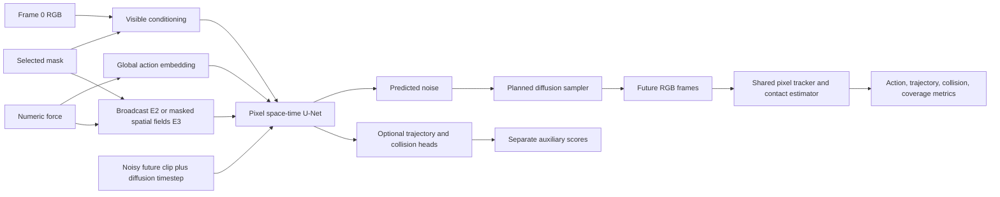

# Achievable architecture and evidence gates

The pixel/latent architecture choice remains a proposal. Simulation, grouped datasets,
trajectory/collision metrics, and a pixel tracker are now implemented. Contact extraction
needs improvement. The diffusion scheduler/sampler, dataset trainer, and CVAE remain to
be built. Synchronize agreed scope changes across the issues, task board, and backlog.

## Recommended first build

Use a **compact pixel-space space-time U-Net**, joint short-clip diffusion, identical
numeric/spatial action inputs, and optional auxiliary heads. Start with 64px, two objects,
and the frozen 32-frame simulator pilot. The synthetic profiler defaults to 16 frames;
set 32 explicitly when measuring the frozen pilot. Profile before changing the horizon
or increasing width. This avoids making a learned autoencoder a prerequisite
before learning whether the actions can be followed.

The original latent architecture remains an option only after a reconstruction gate
shows that object geometry and video-derived contact/trajectory extraction are preserved.
This proposal does not assert that pixels universally outperform latents. It removes
one coupled failure point for the one-month pilot. Source evidence and alternatives are
in [the research review](SOTA_2026-10-14.md).



There is no inference path from future ground truth or hidden physical parameters into
conditioning. Frame 0 is retained exactly when presenting generated videos. The drawing
includes planned modules so it describes the intended system, not current end-to-end readiness.

## Implemented prototype interface

`src/click2future/models/pilot_denoiser.py` provides:

```text
noisy_future:   [B,3,T_future,H,W]
timesteps:     [B]
first_frame:   [B,3,H,W]
selected_mask: [B,1,H,W]
force_xy:      [B,2]
 -> predicted_noise: [B,3,T_future,H,W]
 -> optional positions: [B,T_future,N_max,2]
 -> optional collision_logits: [B,T_future,N_max,N_max]
```

For any configured clip length, collision head index k corresponds to the interval from frame k
to frame k+1, including the initial-to-first-future interval. Mask invalid slots and score
only the upper triangle of symmetric object-pair logits. Object identity/order comes
from the agreed frame-0 contract, not future poses. Position heads predict spatial heatmaps
and take their normalized coordinate moments, preserving absolute image location rather
than regressing coordinates from a spatial average. Collision logits use pooled features.
These are prototype heads; identity-specific prediction must be demonstrated before reliance.

At base width 32 the backbone has **964,035 parameters**, measured by the local profiler.
Widths are 32/64/128 at 64/32/16 pixel grids. Spatial and temporal convolutions operate
separately; four-head temporal attention is restricted to the bottleneck. Skip connections
preserve high-resolution information. Numeric force and diffusion timestep embeddings
modulate all residual blocks. Increase width only if the pilot underfits and its measured
memory/throughput supports it; parameter count is not a quality result.

### Fair conditioning comparison

- **E1:** ignores mask and force internally; only frame 0 is informative.
- **E2:** frame 0, selected mask, numeric action embedding, and broadcast constant fx/fy channels.
- **E3:** same inputs/backbone, but fx/fy channels become `mask * fx` and `mask * fy`.
- **E4:** E3 plus auxiliary supervised outputs, without extra input fields.

E2 and E3 have exactly the same parameter count and learnable topology. The difference
is localization, not target identity or new action information. Broadcasting a numeric
vector is a strong global-conditioning baseline; document it as such rather than calling
it a reproduction of a named paper. At base width 32 with four object slots, E4 adds
2,580 head parameters (966,615 total); record the count for any changed configuration.

Current checks verify shapes, finite gradients, first-frame-only information isolation,
parameter parity and zero-force agreement, spatial coordinate recovery, collision symmetry,
and exact next-update continuity after CPU model/optimizer/RNG restore. They do not establish simulator physics,
sampling quality, dataset learning, or complete mixed-precision trainer resume.

## Alternatives and reasons to defer

| Architecture | Advantage | Main risk | Decision |
|---|---|---|---|
| Joint pixel space-time U-Net | No tokenizer training; one short coherent clip; clear action ablation | Pixel cost and limited inductive bias for contacts | First pilot |
| Learned low-dimensional object dynamics plus renderer | Cheap trajectory generation; explicit identity/geometry | Can become state prediction with analytic rendering, a different visual-generation claim | Diagnostic/staged fallback, clearly labelled |
| Latent video diffusion | Lower spatial cost; room for larger width | Small objects/contact boundaries may be lost; extra AE dependency | Reconstruction-gated option |
| DIAMOND-style autoregressive pixel predictor | Released reference; small next-frame model | Compounding errors and persistent hidden-physics uncertainty | Strong external-method adaptation if budget allows |
| Large pretrained ControlNet/video model | Appearance prior and recent physical-control methods | Different inputs/domain, large dependencies, adaptation/evaluation cost | Optional small external inference comparison |
| Diffusion forcing / large DiT / VLM reward / consistency distillation | Useful at larger scope or after a trained teacher exists | Multiple new coupled stages | Defer for this deadline |

## Implement in order

1. **Generator handoff and contract.** Obtain source and one raw labelled fixture.
   Retain the current centre-force/fixed-duration proposal until the generator's units,
   force/impulse semantics, timestamps, replay and interval contacts are verified. The
   YAML explicitly leaves units/duration pending. Do not infer them from the GIF.
2. **Data/control checks.** Deterministic replay; initially stationary zero-force scene;
   reversed force before contact; target swap; known collision and no-collision cases;
   identical first inputs for hidden-property variants; group-level split independence.
3. **Tracker and CVAE.** Validate tracking and event extraction on simulator controls.
   Fit a conditional VAE with numeric action and selected mask; sample its prior at inference.
4. **Trainable diffusion pipeline.** Add a tested cosine DDPM noise schedule and epsilon
   objective, normalized pixels, optimizer, validation, checkpointing, and DDIM sampling.
   Initial sampler sweep proposal: 16/32/64 steps, selected using validation. Do not
   transplant DIAMOND's three-step EDM result into DDPM without testing the noise/sampler regime.
5. **Evidence gate.** Tiny-batch overfit and a separate held-out action-response test.
   Show zero/reversed/target-change controls with fixed sampling seeds. A random network's
   output changing with force only proves an input path, not learned physical control.
6. **Main conditioning runs.** Freeze data/config/budgets/checkpoint criteria first;
   train E2/E3 independently under the same policy. Record actual seeds and failure rates.
7. **Auxiliary supervision.** Train E4 after E3 works. Use valid-slot trajectory Huber
   loss and valid unordered-pair collision loss with imbalance handling. Define noise-level
   weighting, loss weights and any warm-up on validation before main runs. Watch for
   mean-trajectory/mode collapse and evaluate the sampled videos separately from the heads.
8. **Uncertainty/generalization and demo.** Compare generated/reference ensembles for
   exactly identical visible conditions. Test selected OOD ranges with frozen models.
   Integrate the real sampler into a preset-scene demo with visibly labelled simulator references.

A hidden property cannot be controlled by a UI slider if the model never receives it.
Friction therefore changes the simulator reference in the core demo, not model samples.
Avoid image-only "ground truth" without scene metadata. These existing boundaries remain.

## Predeclare success criteria

Before main runs, choose a primary action-adherence/trajectory metric, collision F1
and prevalence, tracking/object-preservation failure rate, and an ensemble coverage/plausibility
measure. Freeze denominators and whole-sample best-of-K rules. Do not choose numerical
improvement thresholds after viewing test outcomes or treat best-of-K as expected accuracy.

Use paired scene-group uncertainty intervals for E2/E3 differences; aim for multiple
independent training seeds when the measured budget permits. If only one is possible,
report that limitation. A win requires improved behavior without unacceptable collapse,
tracking failures, or unreported compute advantages. Negative results are still valid analysis.

## Deadline and work order

The working submission deadline is **14 November 2026**. No intermediate task dates
are set. Follow the implementation order above and the dependencies in [TASKS.md](TASKS.md).

If the first gate fails, diagnose data/action/optimization and reduce width/horizon before
introducing another model family. Preserve the two-method comparison recorded in the
course plan. Defer 128px, FVD, extra modalities, and optional advanced demo features.

## Cluster and packaging

Follow [the TC2 workflow](../cluster/README.md). Inventory comes before choosing a
cluster backend. Athul's account access and limits are confirmed in [COMPUTE.md](COMPUTE.md); GPU hardware and a successful job still need verification. Save complete model, optimizer,
scheduler, precision scaler, RNG and data-order state for resumable training. The current
CPU resume unit test covers only its defined prototype setup.

Keep source/config/locks and small evidence records in Git; keep datasets, model files,
credentials, local connection reports, and restricted university PDFs outside Git. The
working repository includes URLs and is not the source-only submission ZIP. Use the
existing submission rules and verify the original brief's treatment of dependency metadata.
