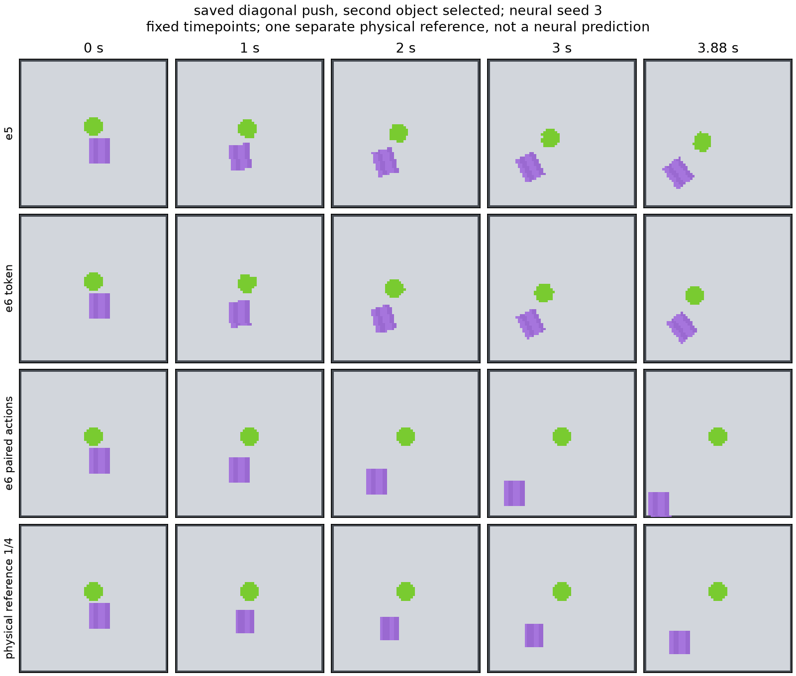

# contact-aware training follow-up

the e5 audit in pr #47 is the baseline: 22/96 clips penetrate by more than one
native pixel, 16/16 zero-force clips drift over the full horizon, and contact event
f1 is 0.2118. the earlier 0/16 drift figure covers the first half-second only.

## frozen first experiment

e6 changes the training package, keeping the e5 model architecture, observable
inputs, renderer and 16-step heun sampler. no projection, zero-force override,
postprocessing or tracker change is added. this is a separate variant and does
not isolate the effect of one loss term.

- original dataset-0.3, seed 730000: 336 training clips, 84 validation clips.
  train-only square symmetry augmentation stays unchanged. all 248 final tests
  remain reserved. no new training data is added in this first comparison.
- same initialization seed 19, width 128/four blocks, batch 64 and 6,000 updates.
  all weights start from scratch. best fixed-seed validation edm loss selects the
  checkpoint; geometry and action results do not select among checkpoints.
- each training draw assigns 25% probability to zero force, 40% to contact
  families and 35% to the remaining actions. stationary examples get an additional
  weighted clean-motion loss. there is no inference-time stationary constraint.
- a differentiable separating-axis calculation uses convex hulls from observed
  frame-0 masks. it penalizes predicted penetration beyond one native pixel and
  gap error near ground-truth contact. future poses supervise training only.
  geometric losses apply at sigma <= 0.3, where the denoising target is local.
- an acceleration-error loss supplements the existing temporal error loss.
  every coefficient is fixed in `configs/training/contact_pilot.json` before the
  allocation. temporal losses compare to labels, allowing real changes at impact.
- training is restricted to tc2 slurm. a four-update device continuation check
  must pass before the model run. the process limit is 20 minutes inside a
  30-minute allocation; interrupted attempts and source hashes are retained.

the torch geometry values are checked against the audit's independent numpy
calculation. degenerate sine/cosine values cannot shrink hulls to evade the loss.
this geometry is an approximate engineering control, not an exact physical solver.

## checks after training

run every frozen validation condition and all changed-selection controls, with
the original four seeds, image metrics and action settings. also replay every
sample pixel-for-pixel before measuring geometry. retain every condition in the
uncertainty strata, including missing tracks and undefined coverage.

the target is learned zero-force stationarity over all 32 frames, fewer deep
penetrations, and improved contact timing without losing action response or
reference coverage. report all counts even if these targets fail. one training
seed and this diagnostic corpus cannot establish generalization or a sota result.

## run

set the source/interpreter/data/revision paths as in the existing tc2 wrappers:

```sh
sbatch submission/train_contact.sbatch
sbatch submission/evaluate_trajectory.sbatch --method E6
```

training uses `C2F_DATA_DIR` and a fresh `C2F_RUN_DIR`. evaluation uses the same
data plus `C2F_TRAJECTORY_CHECKPOINT` and a fresh `C2F_TRAJECTORY_RESULTS`.

## second declared candidate

job 43598 completed the first recipe. full-horizon zero drift is 0/16 and
penetration falls to 17/96 clips, but changed-selection success regresses to
7/16 from e5's 16/16. contact event f1 is 0.3333. the unpushed object can drift
under nonzero force, so this recipe is not accepted as a replacement.

the next six-thousand-update run starts from the same seed on the same corpus.
`contact_token_pilot.json` extends stationary supervision to training tokens whose
labelled pose is unchanged, including passive objects before contact. it raises
penetration/contact weights to 256/64 and the geometric-loss sigma ceiling to
1.0. this combined training change is explicit; it does not isolate one component.
selection, uncertainty, contact timing and every failure remain in the comparison.
no zero-force or passive-object override is used during sampling.

## third declared candidate: paired training actions

the second recipe (job 43600) restores early reversal and changed-selection to
16/16 and keeps zero-force full-horizon drift at 0/16. penetration remains 18/96.
both contact candidates still have passive drift in 8/32 complete forward/reverse
samples over the full horizon; e5 has 22/32. these are additional diagnostics,
not replacements for the original early checks.

the last saved interactive request is also retained: force (-0.42855, 0.25758)
on object index 1 (the second object). e5 reproduces the cached video pixel-for-pixel. its passive object
moves up to 9.83 pixels; the token candidate reaches 11.66 pixels. one matched
simulator realization has no collision and no passive motion. this diagnostic is
not a frozen validation case or a distributional reference.

the generator only selects object 1 for an action toward object 0. whole-scene
symmetries preserve this confound. the third candidate therefore adds a separate,
hashed training-only action supplement to the original corpus:

- exactly the existing 16 training worlds and their four existing physics
  profiles, with both objects selected, eight compass directions and force
  magnitudes 0.25/0.5: 2,048 nonzero clips plus 32 zero-force clips;
- first-frame pixels, object geometry, hidden physics and native rollout settings
  are preserved; only action changes. the original 84 validation clips and all
  248 reserved tests are untouched. no test rollout is opened;
- supplement validation rejects missing actions, changed bytes, changed physics,
  changed parent hashes or non-training membership. angular labels must replay;
- `contact_grid_pilot.json` keeps the token candidate architecture/loss/sampler,
  seed 19 and checkpoint selection rule, with 16,000 updates from scratch and a
  30-minute process limit inside a 40-minute allocation. increased data and
  updates are a combined change, not an isolated causal ablation;
- original validation, exact-pixel replay, calibrated geometry, full-horizon zero
  and passive checks, and the saved interactive request are all reported. all
  three experiments are retained even if the third candidate fails.

this expands training support, not the project's claimed deployment domain. it
cannot establish general image understanding, physical correctness or a sota win.

## reproducibility

training commands require a tc2 compute allocation. create the supplement under
a fresh path, then pass it explicitly; it is never merged into the frozen data:

```sh
python -m click2future.data.action_supplement --parent "$C2F_DATA_DIR" --output "$C2F_EXTRA"
sbatch submission/train_contact.sbatch --config configs/training/contact_grid_pilot.json --supplement "$C2F_EXTRA"
```

the generation command must also run inside an allocated job. the measured run
uses one immutable source release for generation, training and evaluation. source
revision, both data identities, exact resume results and geometry calibration are
stored with the checkpoint. the first two runs keep their original artifacts.

`scripts/replay_contact_push.py` takes the three observable input arrays and
explicit `name=checkpoint` arguments. it checks four matched development physics
profiles separately, never passing their hidden properties to the model. its
32-frame pixel tracks retain missing observations. `scripts/summarize_contact_training.py`
collects every declared candidate and the failed quality gates from raw artifacts.

browser checks cover four simultaneous primary futures at 1440x1080, 1440x900
and 1366x768, mobile overflow, live generation, cached replay, paired seeds,
cancellation, synchronized playback and reduced-motion preference. autoplay
already worked before this change; the functional change is the layout and
single-model default. no latency claim follows from this rehearsal.

## measured outcome, 18 october

| candidate | complete clips /96 | zero drift /16 | passive drift /32 | penetration >1px /96 | early reversal /16 | early selection /16 | contact event f1 |
|---|---:|---:|---:|---:|---:|---:|---:|
| e5 frozen | 87 | 16 | 22 | 22 | 14 | 16 | 0.2118 |
| e6 first | 94 | 0 | 8 | 17 | 14 | 7 | 0.3333 |
| e6 stationary tokens | 94 | 0 | 8 | 18 | 16 | 16 | 0.2449 |
| e6 paired actions | 90 | 0 | 0 | 12 | 16 | 16 | 0.3000 |

all 24 validation conditions and the same four seeds are retained. passive rest
is eligible in all eight forward/reverse cases and complete in all 32 samples.
zero and passive rest cover all 32 frames; the original reversal/selection checks
cover the first half-second. these windows are not interchangeable. contact f1
uses the original approximate tracker and event scorer; missing tracks and scored
counts remain in the [machine record](results/contact-training-validation.json).
none of these candidates passes the strict overall quality gate.

the paired-action run completed 16,000 updates. fixed validation denoising loss
selects step 15,500, checkpoint `278f419d41d4abdfcacbe29b1f38457f608a33200fd29967b13f544df15746b2`.
source is `8b117c7496166c29702eade572a4de94fa7a3c6c`, supplement manifest
`fab734629860bf7454990adf5bdd2695b82ffd9ca4a670efb101f91dce691f30`.
all 96 generated clips pass pixel-exact geometric replay. the 84 physical
reference controls still have zero penetrations above one pixel. training-label
maximum penetration is 0.9354 pixels and validation calibration is 0.8547 pixels.

on the saved diagonal request, passive excursion falls from
[5.87, 1.00, 3.61, 9.83] pixels to [0, 0, 0, 0] over the original four seeds.
all four known physical profiles also leave that object still and contact-free.
the pushed object's generated excursions are [28.65, 31.02, 22.72, 33.76] pixels,
versus [22.10, 20.56, 21.28, 15.49] in those references. the excessive travel is
visible in the fixed-timepoint comparison. four references do not establish the
full outcome distribution. the original e5 cached videos are reproduced exactly.



the supplement and longer training improve stationary behavior and reduce deep
penetrations together. their separate effects have not been isolated. contact
timing remains weak, 12 clips still penetrate deeply, and six have incomplete
tracks. keep this as an experimental comparison rather than silently replacing
the frozen handoff. inspect those contact/track failures before another run;
final id/ood tests, independent repeats and calibrated uncertainty remain open.

jobs 43598, 43600 and 43605 all completed with exit 0. their full allocated times
are 5:13, 5:09 and 13:40: 24:02 total on one a40. the last process uses 418,288,640
peak allocated cuda bytes and 639.84 seconds including label preparation; its
allocation also includes data generation and evaluation. no job remains queued.

542 tests plus 4 subtests pass from a clean source extraction, with six existing
lpips/torchvision deprecation warnings. 30 browser checks pass; the real e6 demo
adapter matches all four offline samples pixel-for-pixel. the source zip is
revalidated after readme-only changes. [verification record](results/contact-training-checks.json).
the demo is closed. private raw checkpoints, logs, source snapshots and all three
attempts are retained in the draft [experiment backup](https://github.com/athul1810/click2future/releases/tag/contact-training-2026-10-18).
