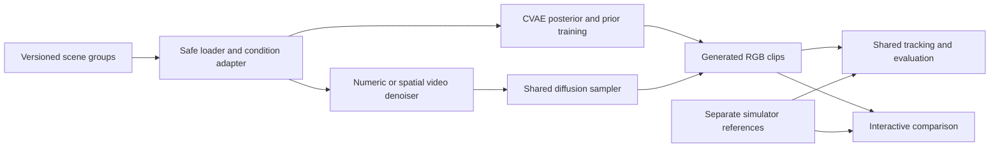

# Click2Future execution plan - 16 October 2026

## Objective and dates

Deliver a convincing learned-video demo and a rigorous comparison of conditional VAE
and video diffusion. The research target is improved action control and credible hidden-physics
uncertainty under a declared information/compute budget. A grade or SOTA result cannot be
guaranteed. The controllable commitments are correct experiments, strong baselines,
reproducible evidence, clear analysis, and a reliable presentation.

**14 November 2026 is the PPT presentation date**, confirmed by Shrijeet on 16 October.
The live slot length and report/code submission cutoff still need confirmation. Keep
14 November as the conservative working submission date until the 14/16 November
discrepancy is resolved. All proposed dates below use Singapore time.

This is an execution proposal. It preserves the current owners: Sanjay on A, Shrijeet
on B, Athul and Ananya jointly on C. CVAE/demo ownership remains pending at Shrijeet's
explicit instruction. It does not silently reassign issues, adopt new physics, or change
the frozen dataset. After team agreement, synchronize affected GitHub issues,
[TASKS.md](TASKS.md), [task_backlog.json](task_backlog.json), and [DECISIONS.md](DECISIONS.md).

## Verified starting point

- Main is `323c573`; integrated PR #25 is `f8764b7` at this review. PR #24 merged the
  simulator/data pipeline. PR #25 combines that with development and evaluation work.
  Review this integration before merging; the older #21 conflicts with main.
- Local checks passed: 128 tests and four subtests, Ruff lint/format, dependency checks,
  40 generated clips, exact saved-sample replay, and a finite CPU denoiser forward pass
  on a real `[2,3,31,64,64]` future batch. This is not dataset learning or sampling.
- Frozen pilot: 64px, 32 total frames at 8 FPS, frame 0 before a centre force lasting
  0.25 seconds; 2-4 objects; hidden mass/contact friction/restitution.
- The frozen `dataset-0.1` integration dataset has 250 scene groups and four physics
  variants per condition. Preserve it. New action mixtures, scale, physics or OOD
  distributions need an explicit dataset version; do not overwrite it.
- CVAE, diffusion trainer/sampler and demo do not exist. Pixel/latent choice remains
  proposed. Contact extraction's recorded held-out F1 is 0.311, recall 0.233.
- Athul has recorded TC2 approval. GPU model/VRAM, an allocated job, throughput and
  complete training resume remain unverified. Shrijeet reports both application and
  GPU/VPN coordination emails sent; replies were not accessed.

Small local review evidence is recorded in
[planning_preflight_2026-10-16.json](results/planning_preflight_2026-10-16.json).
Current definitions remain in [ARCHITECTURE.md](ARCHITECTURE.md) and
[METRICS.md](METRICS.md).

## What the presentation should demonstrate

The central experiment is: **same visible scene, changed push, coherent changed futures**.
The audience should see the selected object move, another object respond to contact,
and multiple plausible outcomes because physical properties are hidden.

1. Click an object and drag a centre-anchored force arrow. Generate four synchronized futures.
2. Reverse the force with the same sampling seeds. The response changes appropriately.
3. Switch CVAE/numeric/spatial models on the same request. Discuss measured differences,
   including cases where the proposed component does not win.
4. Reveal independent simulator futures for identical visible inputs. Show reference and
   generated endpoint/trajectory distributions, not just four visually different clips.
5. If the core is complete, add goal-region action search: the learned models suggest a
   push, then a separate simulator rollout checks its outcome. This extension is gated.

See the [demo specification](../app/DEMO_SPEC.md). Main controls stay simple; detailed
run provenance belongs in an optional inspector. Measurements use original-resolution
outputs even when the screen enlarges them.

## Research ceiling and comparison ladder

Force control, spatial physics maps and physics/video coupling are established. The
[16 October source addendum](SOTA_2026-10-16.md) adds Goal Force, PHANTOM and PhyParam
to the [earlier review](SOTA_2026-10-14.md). These prevent inflated novelty claims and
inform the design; they are not automatically comparable on one leaderboard.

| Level | Experiment | Completion evidence |
|---|---|---|
| Required two-method comparison | E0 conditional VAE versus E2 video diffusion | Own trained models, common held-out data, quality/control/cost table |
| Main controlled hypothesis | E2 numeric versus E3 localized force fields | Same information, backbone, initialisation policy, data, training and sampling budget |
| Physics improvement | E3 versus E4 auxiliary supervision | Valid slot/event losses; generated-pixel improvement, not head accuracy alone |
| Contextual diagnostic | E1 without action | Quantifies the value of action input; not the strong primary baseline |
| Strong external adaptation | DIAMOND-style released autoregressive pixel model | Continuous-force/mask adapter, same observable inputs; original deviations and full cost documented |
| Optional foundation transfer | One supported Force Prompting/Goal Force/PhyCo inference comparison | Working released stack, defensible interface mapping, separate transfer/pretraining setting |

Target three independent training seeds for the main comparisons, starting by funding
E0/E2/E3. E4, E1 and the external adaptation receive explicit budget decisions before
main runs. A single external pilot is not a statistically established victory.

Time-box the external-method feasibility investigation to one working day by 24 October.
Do not replace its unavailable implementation with an unlabelled home-made approximation.
If we only complete the internal comparison, describe a controlled study, not a SOTA win.
Even an external win on our task does not establish superiority on its original benchmark.

## Four-person execution and interfaces

| Workstream | Current lead | First handoff | Reviewer / partner |
|---|---|---|---|
| A: data and physics | Sanjay | Physics decision, versioned control fixtures, multi-action scene groups, loaders/manifests | Shrijeet for model interface; C for labels |
| B: diffusion | Shrijeet | Safe condition adapter, trainer/sampler, resume, E2/E3 pilots and inference API | C for controls; D for integration once assigned |
| C: evaluation and physics | Athul + Ananya | Tracker reliability, action/uncertainty metrics, calibrated contacts, experiment protocol and tables | A for oracle controls; B for model outputs |
| D: CVAE and demo/integration | **Owner pending** | CVAE baseline, interactive UI, inference integration and presentation reliability | B for model API; C for fair scoring |
| TC2 run coordination | **Owner pending** | Allocated GPU inventory, environment, training/sampling/resume measurements | Athul has approval; account holder runs their jobs |
| Presentation assembly / submission coordination | Sanjay coordinates as group coordinator; assembly owner pending | Slot/cutoff confirmation, combined deck, rehearsals, upload checklist | Every member owns their technical content |

Athul/Ananya remain joint owners of C. Agree a non-overlapping internal division of
tracking/contact work and action/uncertainty/aggregation work; review each other's outputs.
Every person writes their own method/results/limitations and records contribution evidence.

**Resolve D and TC2 coordination by 17 October.** Until then those deliverables are
unallocated, not assumed covered. The plan is not fully staffed while the required
CVAE and the main demo have no lead. Continue independent A/B/C work while this is resolved.

Shared interfaces to freeze together:

- Conditions: frame-0 RGB, selected mask, normalized force, horizon and sampling seeds.
  Hidden physics, future labels and entire scene dictionaries are excluded from model inputs.
- Training batch: explicitly typed inputs, future RGB targets, valid object slots and
  optional labels. Preserve source IDs and record any auxiliary-slot permutation.
- Inference: four videos including unchanged frame 0, with model identity, seeds and timing
  in the run record. Demo and evaluation call the same preprocessing and sampler.
- Results: a shared machine-readable record with data/split/config/checkpoint hashes,
  train/sample seeds, hardware, precision, denominators and failures.

## Resolve physics and identity before scaling

### Contact friction versus tabletop drag

The current backend assigns shape contact friction but has no tabletop drag term.
In a contact-free probe, changing friction 0.1 to 0.8 produced identical RGB/positions;
post-force speed stayed approximately 0.05 world units/second.

Preferred scope for the first trained model: retain the frozen contact-friction model
and demonstrate uncertainty from mass and contact outcomes. Do not present friction as
free-sliding slowdown. If tabletop slowing is essential, A must implement and verify a
separate floor-friction/drag model by 18 October, version the contract and regenerate
the affected data before main training. A frozen schema is not permission to misdescribe
its physics. Avoid a late physics change after experiments begin.

### Object identity

Sampling-order IDs are stable for replay but are not guaranteed recoverable from RGB.
A valid ID permutation can preserve frame-0 RGB, selected mask and force while permuting
trajectory targets. Before E4, canonicalize auxiliary slots using centres measured from
visible frame-0 pixel masks (deterministic x/y ordering), or use a justified permutation-aware loss. Keep one
mapping for the whole clip and map correctly for evaluation. Do not fix this by giving
extra ID/mask inputs only to the proposed model.

## Model architecture and first implementation

Use the existing compact **pixel-space space-time U-Net** first. It predicts all 31
future frames jointly. Numeric force and timestep embeddings modulate the residual
blocks; temporal attention stays at the bottleneck. At width 32 it has 964,035 parameters.
E2 broadcasts force channels; E3 localizes those channels with the same selected mask.

Starting defaults are proposals for validation, not established optimal settings:

| Item | Initial choice / check |
|---|---|
| RGB | Convert `[0,1]` to `[-1,1]`; invert consistently for output |
| Future shape | Loader `[B,T,3,H,W]` to denoiser `[B,3,T-1,H,W]`; preserve frame 0 |
| Action | Divide simulator force by the declared 0.5 scale; never silently clip OOD forces |
| Resolution/horizon | 64px, 32 total frames at 8 FPS; record any explicit shorter development crop |
| Noise objective | Cosine DDPM schedule, 1,000 training timesteps, epsilon prediction |
| Sampler | DDIM; validation sweep at 16/32/64 steps with fixed seeds and full quality/latency measurements |
| Optimization | AdamW, initial learning rate 1e-4, gradient clipping, EMA; finalize on validation |
| Precision/batch | Profile batch 1/2 at the full horizon; use supported bf16 or tested fp16 scaling; record effective batch |
| Heads | Disabled for E2/E3; valid-slot positions and unordered-pair collision labels for E4 |

CVAE must have a future-conditioned training posterior and a prior usable from the
allowed condition alone. Sample the prior during evaluation. Check KL/latent usage and
mode collapse; a deterministic reconstruction disguised as a stochastic baseline is inadequate.
Give CVAE a documented validation-tuning budget rather than one unsuccessful run.

Train E2 and E3 independently from the same initialization/data-order policy. Do not
warm-start one from the other for the primary comparison. E4 adds only the declared
heads/losses, with low-noise weighting and loss weights chosen on validation. Strong
trajectory regression can collapse uncertainty; verify the sampled videos separately.

No unconditional energy-conservation or minimum-jerk penalty: external forces, dissipative
contacts and hidden mass invalidate a blanket rule. Foreground-loss reweighting, if needed,
is a documented shared pipeline change, not an undisclosed advantage for E3.

Keep latent compression as a measured alternative. Adopt it only if a proven pixel
bottleneck justifies it and reconstructed object boundaries, tracks and contact behaviour
survive a train-only-fitted autoencoder. A larger DiT, VLM reward loop, learned physics
branch or distillation teacher is not an initial prerequisite.

## Data and benchmark construction

1. Preserve `dataset-0.1` as the integration reference. Create a new manifest/version
   for main-training distributions; choose scale after the pilot learning curve and IO profile.
2. Include multiple actions/targets for the same visible scene, not only multiple hidden
   physics draws for one action. Group every action and physics variant of that scene in
   the same split. Encode action-specific `condition_id` and collision-free sample IDs.
3. Include free motion, direct/glancing contact, near misses, wall interaction and zero/reversed
   forces. Enrich scene families using visible geometry, retaining all sampled physics
   variants; filtering individual variants by future collisions would distort the hidden prior.
4. Start with two objects, then add 3-4-object training/evaluation only after the two-object
   model works. Distinguish object-count OOD from an ID object-count mixture.
5. Reserve all seeds already used by calibration, controls, development and review. Freeze
   fresh validation/test scene manifests before model selection. No test-driven preset/checkpoint selection.
6. Define actual disjoint OOD ranges. For example, a new training version could use zero
   and nonzero magnitudes 0.15-0.35, reserving 0.4-0.5 for force OOD. A model trained on
   the original full range cannot claim that range as OOD. Do not rename colour changes
   as texture OOD or resized rectangles as unseen shape families.

Proposed final measurement targets, subject to measured inference cost and T13 freeze:
200 independent ID scene groups; a separate 64-group paired-action suite; and 64 conditions
with K=16 model draws and L=32 reference draws for distribution analysis. K=4 is the demo
view, not evidence of calibrated probabilities. Declare subset overlap and actual counts.
Shape/texture OOD requires working generation and validated tracking; otherwise change
the declared scope and discuss the omission before final runs.

## Evaluation and statistical evidence

Primary comparison: E2 versus E3 on predeclared action-response, failure-rate and
trajectory-distribution measures. Use ADE/FDE as single-reference diagnostics, not a
complete judgment of multimodal futures. Keep selected-object and all-object scores.

- Action: fixed contact-free early window, direction, visible-motion/stationary rate,
  zero-force drift, reversed force, target swap and magnitude response. Pair sampling
  seeds, but do not claim a seed identifies the same hidden mass under every action.
- Tracking: quantify missing objects, fragmentation, colour/area changes and out-of-bounds
  outputs. Validate on clean simulator clips and deliberately corrupted clips resembling
  model failures. Report completeness alongside every trajectory score.
- Uncertainty: reference coverage AND generated-sample plausibility, endpoint/trajectory
  spread, and a proper distribution score such as the
  [energy score](https://www.tandfonline.com/doi/abs/10.1198/016214506000001437).
  Implement and test its normalization and finite-sample estimator first. Label any
  complete-track cohort and report failures separately; censoring failed generations
  does not preserve a whole-population proper-score claim. Reject a metric win created
  by increased untrackable output.
- Collisions: the present 0.233 recall is not adequate for confident model ranking.
  Calibrate on a separate set with enough positive events and test on fresh cases.
  Proposed engineering gate: precision and recall each at least 0.8 on a held-out
  clean/corrupted-control suite, with counts and intervals. This is not a course rubric
  threshold. If it fails, retain contact scores as exploratory, report the limitation,
  and use validated motion/object-preservation measures for the main conclusion.
- Image/temporal: add SSIM and optional LPIPS with fixed preprocessing. Check static-copy,
  shifted-video and flicker controls. Score contact-aware jitter rather than penalize
  legitimate collision impulses. Include valid fractions and failures.
- Statistics: target three training seeds, paired comparisons on the same independent
  scene groups, seedwise results, and scene-group uncertainty intervals. Do not count
  correlated action/physics variants as independent observations. Best-of-K selects
  one complete clip; show expected sample performance separately.
- Cost: parameters, total training GPU-hours including inherited work, precision,
  sample count, sampler steps, and measured end-to-end median/p95 four-future latency.

Freeze thresholds, sampler settings, checkpoint criteria and primary metrics on validation
before final test use. Keep a small set of representative failures in the report and deck.
If E3/E4 do not win, deploy the best validated model and explain the negative result.

## GPU operations and run budget

The first allocated job records GPU/VRAM, driver, OS, framework and actual QoS/storage
limits, then exercises a real training update, full sampling, save/interruption/resume and
data IO. The six-hour job limit is not a measured total project quota. Keep GPU execution
on allocated compute nodes and use the account holder's access.

Budget from measured seconds/update and seconds/four-sample request, including warm-up,
validation, inference, queue effects and retries. Initial budget policy: fund required
models/repeats first, reserve at least 15% for final evaluation/presentation and 15% for
failures. Change this policy if measured evaluation cost is larger; never invent an
A100-hour entitlement. Advanced experiments need a funded cost before launch.

Complete checkpoints include model/EMA, optimizer, scheduler, scaler, RNG, data order,
step and resolved config. Save at safe update boundaries, verify reload across a job
boundary, and stop with time for a final checkpoint before the job limit. Back up run
records and essential weights outside TC2; do not rely on its home directory as the only copy.

## Milestones to the 14 November presentation

These are proposed delivery targets, not benchmarked runtimes or existing team commitments.

| Date | Deliverable / exit evidence |
|---|---|
| 16-17 Oct | Review integrated #25; resolve D/compute ownership; confirm PPT slot and submission cutoff; choose physics/identity policy; request allocated GPU inventory |
| 18-20 Oct | Real adapters, CVAE and diffusion train/sample paths; tiny-overfit controls; full checkpoint/resume; actual GPU/IO/sampling measurements |
| 21-23 Oct | Held-out action-responsive E0/E2/E3 pilots; usable prior sampling; validated tracker controls; first real-model UI integration |
| 24 Oct | Freeze main data/config/metric protocol and budget; external-baseline go/no-go; documented hyperparameter study; decide pixel/latent and advanced-demo scope |
| 25-30 Oct | Main E0/E2/E3 repeats; E4 and external adaptation if funded; no test-based tuning; record all failures/costs |
| 31 Oct | Checkpoint/experiment freeze for final evaluation; core UI feature freeze |
| 1-4 Nov | Final ID/OOD/action/uncertainty measurements; aggregation and confidence intervals; traceable figures and failure examples |
| 5-7 Nov | Report/deck first complete draft; polished demo, latency measurements, local fallback and Q&A appendix |
| 8 Nov | Full timed rehearsal on the actual presentation laptop; every required figure and both method families present |
| 9-11 Nov | Repair rehearsal failures; final report/contribution/source-package checks; no new model family |
| 12 Nov | Second full rehearsal, including an offline fallback and arbitrary allowed force/target changes |
| 13 Nov | Final presentation-device check, embedded assets, backups and submission readiness |
| 14 Nov | PPT presentation; submit coursework files by the separately verified cutoff |

Stop large runs if tiny overfit or held-out controls fail. Diagnose data/timing/normalization,
noise schedule, optimization and foreground preservation before scaling width. Preserve
the two-method comparison and reliable evidence when cutting optional scope. If D remains
unassigned or no usable pilot exists by 23 October, the plan is off track: record a named
recovery allocation and reduce optional scope immediately rather than conceal the gap.

## Demo acceptance and stretch gate

Required: real sampled videos, four synchronized futures, force/target changes, model
comparison, simulator reference, seed repeatability, loading/error/cancel states, readable
large-screen visuals and offline presentation assets. Same request preprocessing and
checkpoint as evaluation. Show an explicit live/cached-replay state.

Target a four-future response within 15 seconds on the actual presentation device after
warm-up; this is a UX target, not a measured promise. Measure p95 and end-to-end cost.
If it cannot be met, use progress feedback and clearly labelled exact-request replays;
retain a real live path when available. Do not substitute simulator playback for inference.

The goal-region search extension starts only when the core model follows changed actions,
the demo is stable, the extension has an owner, and its measured cost fits. Use the CVAE
to propose candidate actions and diffusion to re-score a small shortlist, using generated
pixels only. The simulator checks the selected action afterwards and never supplies search
outcomes. Report success on a fixed held-out goal set against random-action and CVAE-only
controls. Goal-conditioned generation/planning is established by Goal Force; this is a
useful application extension, not a novelty claim by itself.

## PPT, report and assessment evidence

Build an eight-slide core, then adapt to the instructor's confirmed slot:

1. Task and why one image permits several futures.
2. Closest work and our exact comparison/claim boundary.
3. Data, force semantics, hidden variables and independent splits.
4. CVAE/diffusion architectures and matched E2/E3 intervention.
5. Main quality/control/cost results with actual seeds and failures.
6. Component/sampling-step analysis and uncertainty/OOD evidence.
7. Live demo with a rehearsed local fallback.
8. What worked, strongest failure, limitations and next step.

Appendix: noise objective, CVAE prior/posterior, slot mapping, physics assumptions,
contact calibration, dataset counts, run budgets, external adaptation deviations and
extra failure examples. Every member can explain the full data-to-result path and their contribution.

The rubric matrix below uses the repository's transcription of the course brief.
The original brief was not found in the bounded local search; Sanjay must confirm
the original/current NTULearn instructions. No numerical marking weights are assumed.
Confirm the treatment of dependency metadata and required third-party notices when
checking the submission's external-link restriction; do not strip required notices.

| Assessment need | Evidence to finish | Accountable work |
|---|---|---|
| Clear task and methods | Formal condition/output definition, related-work comparison, architecture figure | B, with all reviewers |
| At least two methods and one dataset | Trained CVAE and diffusion; versioned procedural benchmark and own results | D pending, B, A |
| Hyperparameter analysis | Validation-selected sampler-step quality/latency curve; CVAE tuning documented | B, D pending, C |
| Component analysis | Matched E2/E3 and E3/E4 where feasible; full costs and seed counts | B and C |
| Insightful comparison | Action, uncertainty, OOD and failure analysis; discuss negative results | C with all method owners |
| Useful visualizations | Comparable strips, arrows, tracks, endpoint distributions, cost curve and representative failures | C, D pending |
| Organization and communication | Complete report, timed PPT and two rehearsals | Coordinator and all members |
| Contributions and reproducibility | Reviewed contribution descriptions, run manifests, clean extraction and source checks | All; packaging owner pending |

Finish `group_07_report.pdf` (at least four substantive pages),
`group_07_contribution.pdf`, and `group_07_code.zip` according to [SUBMISSION.md](SUBMISSION.md).
Keep PPT and demo assets available locally for the confirmed presentation; do not assume
they are extra required uploads. Embed assessed figures/results in the report. Build a
separate source-only ZIP with no datasets, weights, Git history or external links, and
test it from a clean extraction. Retain required third-party notices. The final audit
checks actual rubric coverage and scientific correctness; it cannot guarantee a grade.
