# Roadmap

**Working deadline: 14 November 2026.** The team chose to retain this date until confirmed; the supplied PDF lists 16 November. See [SUBMISSION.md](SUBMISSION.md) for the three required files and exact packaging rules.

Intermediate milestones and task dates have not been set. The team will agree on them later. The dependencies below describe the order of work, without assigning dates.

## Critical path

```mermaid
flowchart LR
    T04[Data contract] --> T05[Simulator]
    T05 --> T06[Dataset and splits]
    T06 --> T08[Autoencoder]
    T08 --> T10[Diffusion baselines]
    T10 --> T11[Spatial conditioning]
    T11 --> T12[Auxiliary heads]
    T12 --> T13[Experiment settings and budget]
    T13 --> T14[Core ablations]
    T14 --> T19[Reproduction and release]
    T19 --> T20[Submission]
```

This diagram shows the main model-training path. The [task board](TASKS.md) lists all prerequisites, including metrics and baseline checks before T13. Metrics, the CVAE, report outline, and demo shell can progress alongside this path using agreed fixtures. Integration still requires the real dataset and checkpoints.

## Checkpoints

**Compute and setup.** Complete the TC2 application and access setup, then measure memory use and throughput. Continue CPU simulator and data-contract work while arranging access. Adjust model and experiment size to the assigned TC2 capacity.

**Check the 64px baseline.** Require a small-batch overfit check, interpretable reconstructions, valid samples, and measured training cost. Debug data/model issues before launching the ablation suite.

**Fix the experiment settings.** Fix datasets, metrics, sample counts, and run budgets. Scale to 128px only if the 64px evidence and remaining GPU budget justify it. Use 128px for a targeted follow-up, not an automatic second full sweep.

**Prepare for submission.** Complete the analysis, report, contribution statement, and source-code ZIP. Check both PDFs and inspect the extracted ZIP. Keep trained checkpoints and optional demo recordings in the team's working files, outside the submitted package.

## Team coordination

- Keep each task's GitHub issue updated with its owner, branch, blockers, and evidence.
- Review interfaces before merging data/model/evaluation changes.
- Test a full scene-to-samples-to-metrics path when components are ready to integrate.
- Link runs in [experiments/](../experiments/) and measured tables in [results/](../results/).
- Raise blocked tasks at the next team check-in and reassign work if needed.

## Reduced-compute fallback

Keep 64px as the final resolution, use shorter clips if profiling requires it, cap dataset size, and start with one seed for smoke runs. Prioritize the E2→E3→E4 contribution comparisons while preserving E0/E1 as small-budget contextual baselines. Use additional seeds for the main comparisons when affordable, disclose seed counts, and avoid overstating single-run differences. FVD and friction-conditioned generation can be dropped without changing the main question.
