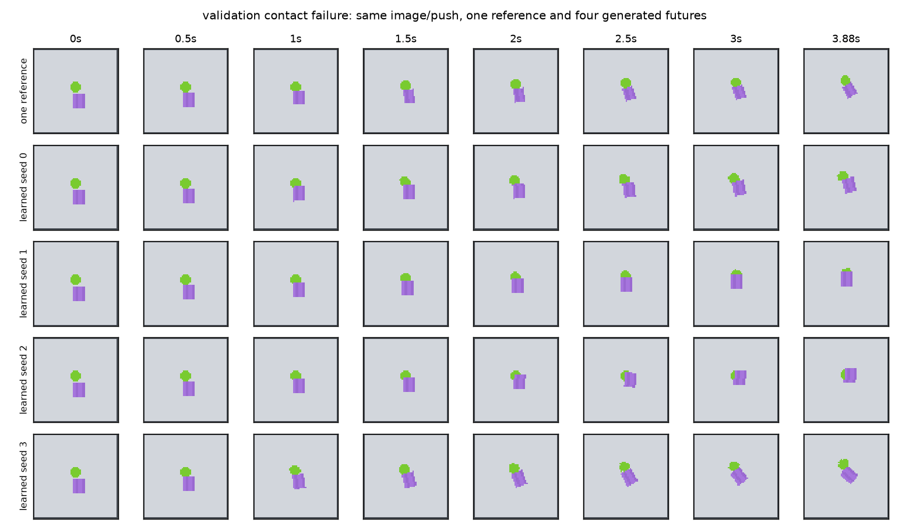
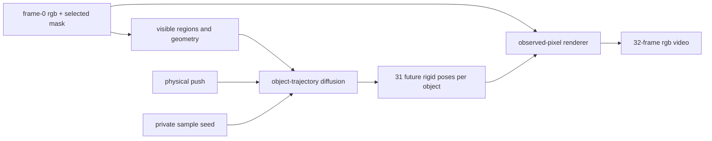

# object-trajectory diffusion pilot

e5 improves action response on the frozen validation scenes, but still fails the
strict video-quality gate. it is an additional supervised method. it does not
replace e2/e3, establish a conditioning-only improvement, or beat an external sota.

## measured result

| check | e5 result |
|---|---|
| generated-pixel tracking | 5,895/5,952 observations, 99.04% |
| complete selected-object clips | 93/96 |
| complete all-object clips | 87/96 |
| push reversal | 14/16 paired seeds pass; two pairs remain below the motion threshold |
| changed selected object, same push | 16/16 paired seeds pass at force magnitude 0.4 |
| zero-force drift | 0/16 clips exceed the fixed threshold |
| contact event f1 | 0.2118 against one reference future |
| strict tracking/selected-trajectory gate | **fails** |

these are four validation scenes and one training seed. the original action
window is 0.5 seconds with a one-pixel motion threshold. its rendered physical
references pass only 8/16 reversal pairs at the original weak forces; that limits
interpretation of the model's 14/16. changed-selection references pass 16/16.
the tracker remains candidate v2 pending independent review.

all 57 missing observations are `area_change` rejections in contact conditions.
free-motion, zero-force and wall cases retain every observation. this points to
contact/overlap handling as the next target; it does not justify changing tracker
thresholds. timing and reference coverage remain weak or undefined. the complete
counts, null values, reference checks, bootstrap intervals and per-case failures
are in [the validation record](results/trajectory-pilot-validation.json).



the selected failure case shows substantial overlap in some generated futures.
one reference is shown for context; alternate valid motion is expected, but
interpenetration is not evidence of useful uncertainty.

## model and information budget



- exactly two separately visible objects on a flat tabletop background, native
  64px rgb, 32 frames at 8 fps and a 0.25-second push. arbitrary photos, occluded
  initial objects and changing appearance are outside this checkpoint's scope.
- object order comes from initial centroids and stays fixed when selection
  changes. each token gets visible geometry and its local force, routed through
  the selected-mask flag. hidden mass, friction and restitution are unavailable.
- the denoiser uses four transformer blocks, width 128, four attention heads and
  62 future object/time tokens. each predicts centre displacement and relative
  sine/cosine rotation. train-only square rotations/reflections transform the
  image, masks, force and motion consistently.
- edm preconditioning and weighted denoising use sigma-data 0.25. sampling uses
  16 rho-7 heun steps, 31 network evaluations per future, float32 and no churn.
  the temporal auxiliary loss penalizes changes in denoising error across time.
- future positions and checked replay angles supervise training. the original
  clips have no angle array, so the label helper replays their physics and checks
  every stored position within 1e-6. it never runs during neural inference.
- the rigid renderer transforms the actual observed object pixels. no simulator,
  hidden coefficient, future mask, trajectory correction or collision fallback
  supplies generated motion. exact frame 0 is retained.

the factorization follows the motion/appearance direction in
[physctrl](https://cwchenwang.github.io/physctrl/), under a smaller observable-only
interface. the numerical starting point is
[edm](https://github.com/NVlabs/edm), with our trajectory network, smaller noise
range, temporal loss and float32 integration. this is an independent small model,
not a reproduction of either system. the broader released-method comparison is
in [the research notes](ACTION_QUALITY_2026-10-17.md).

## training and checks

tc2 job 43396 completed 6,000 updates on one a40 in 160 allocated seconds
(151 seconds including preparation inside the training process). seed 19, batch
64, adamw, learning rate 3e-4 and ema 0.995. 336 training clips become 2,688
augmented examples; all 84 validation clips stay unaugmented. checkpoint selection
uses fixed-seed validation denoising loss, selecting step 5,000. sampling quality
is evaluated separately. all 248 final-test clips remain reserved.

the cuda resume probe reproduces subsequent losses, model weights and ema weights
exactly. unit checks cover edm equations, positive image axes, rotation, object
permutation, force routing, private seeds, checkpoint/source contracts and demo
sampler parity. the renderer control tracks all 20,832 training and 5,208
validation observations when supplied **oracle motion**. its validation ade is
0.00473; this is rasterization/calibration evidence, not learned model accuracy.
see [the renderer control](results/trajectory-renderer-ceiling.json).

evaluation job 43403 stopped on a missing ss​​im dependency. its failed attempt is
retained. job 43404 installed pinned scikit-image 0.26.0, passed dependency checks
and completed both frozen suites. this follow-up measures ssim; lpips was not run.
metric thresholds, sampling seeds and test reservation were unchanged.

the local e5/e3 demo passes 25 browser checks. five fresh warm requests, after one
warm-up, take 5.31 seconds median and 5.36 seconds empirical p95 through the first
painted canvas on the rtx 3060 laptop. those requests generate four futures from
each model and include tracking, reference rendering and transport. loading is
excluded. this is a small-sample latency estimate, not a quality certificate.

## reproduce

run training inside a tc2 slurm allocation with the project environment active:

```sh
python -m click2future.training.train_trajectory --dataset data/frozen --run-dir runs/trajectory --config configs/training/trajectory_pilot.json
python -m click2future.evaluation.trajectory_pilot --dataset data/frozen --checkpoint runs/trajectory/best.pt --output outputs/trajectory-validation --device cuda --steps 16
```

`submission/train_trajectory.sbatch` and `submission/evaluate_trajectory.sbatch`
provide the resource limits and deterministic cuda environment. set their required
`C2F_*` paths/revision before submitting; neither script installs packages or uses
the login node for model work. the source readme documents corpus generation.

the strict loader checks the model-source hash against the checkpoint. training
source revision is `df2e9d7bfc1c80f46ef9ef4ef080c4d396f6674b`; the recorded evaluation
uses `7682ea2282dd35e156a420ac5c3b941ea16b7ed3`. later input-validation checks do not
change the saved model or the sampler equations. original artifacts are packaged
in the internal checkpoint handoff; all weights/data stay outside the source zip.

## next decisions

1. add independent training scenes and more contact geometries with sanjay while
   retaining this frozen corpus as a diagnostic. bind any new corpus to new
   hashes/splits. do not inspect the reserved tests to choose training examples.
2. test contact-aware training against this checkpoint. measure overlap, event
   timing, missing tracks and diversity together; no renderer/tracker patch that
   hides invalid motion. keep ananya's cvae work and the matched e2/e3 study separate.
3. freeze a useful variant, repeat independent training seeds and assess
   multi-reference coverage before opening final id/ood suites with athul/ananya.
4. rehearse contact propagation, reversal and selection on the final presentation
   setup. add uncertainty visualization only when its underlying tracks are usable.

no 128px scale-up or large pretrained-model training is justified by this pilot.
an external adaptation still needs a pinned implementation, compatible force
interface and measured a40 runtime before any superiority claim.
